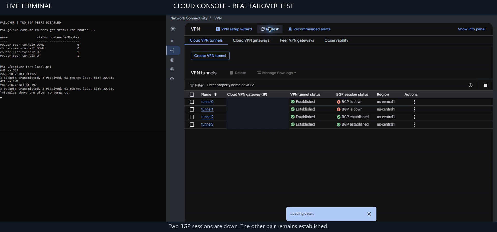
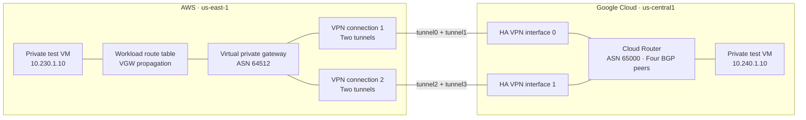

# AWS ↔ Google Cloud HA VPN with Terraform

A four-tunnel, BGP-routed connection between an AWS VPC and a Google Cloud VPC. This lab demonstrates a complete network deployment, private workload connectivity, controlled route failover, temporary deployment credentials, and tunnel diagnostics.

The configuration also preserves an important fix from the original deployment: **explicitly assign GCP the second usable address of each tunnel’s `/30`, and peer with AWS’s first usable address.** IPsec being up does not mean BGP is working.

## Watch the console-and-terminal demo

[](demo/aws-gcp-console-terminal-failover.mp4)

**[Watch or download the captioned video — approximately 61 seconds](demo/aws-gcp-console-terminal-failover.mp4).**

This sanitized recording shows the actual terminal beside the actual cloud consoles, with small captions explaining each stage. Deployment-specific IPs, resource identifiers, and local paths are masked; the original recording stays private. Visible stages include:

- Two BGP peers down while the other pair remains established.
- Private-VM ping samples in both directions.
- The Terraform restore command and apply.
- Four established GCP BGP sessions after recovery.
- Both tunnels UP on the displayed AWS VPN connection, with logging enabled.

The edit starts after the withdrawal apply. Waiting periods are cut, and the accelerated apply section is marked **3× playback**. This is a BGP route-withdrawal experiment; IPsec transport was not deliberately disabled. Console/serial output and cloud telemetry can lag current network state. The three-packet samples do not measure exact convergence time or uninterrupted reachability. See [capture notes](demo/README.md) and the reusable [subtitle file](demo/aws-gcp-console-terminal-failover.srt).

The footage was captured before teardown. The test network has since been destroyed so the configuration can be applied again. This directory is the public template; it contains example network ranges and placeholders rather than live deployment settings.

## Architecture



| Component | Configuration |
|---|---|
| AWS VPC / workload subnet | `10.230.0.0/16` / `10.230.1.0/24` |
| GCP workload subnet | `10.240.1.0/24` |
| AWS routing | VGW, dynamic routing, route propagation into the workload route table |
| GCP routing | Cloud Router, explicit advertisement of the actual workload subnet |
| Tunnel layout | Two AWS VPN connections, four tunnels across both GCP HA VPN interfaces |
| Workload tests | Optional private VMs, ICMP access between the configured workload ranges, no VM public IPs |

GCP tunnel, interface, and BGP-peer resources use a `locals` map and `for_each`. The AWS customer gateways select GCP’s public addresses by **interface ID**, avoiding reliance on collection ordering. GCP’s peer gateway reads the four AWS public tunnel addresses directly from the AWS VPN resources.

## Debugging note: BGP inside-IP collision

### Symptom

During the original deployment, all four IPsec tunnels reported up, but the BGP sessions never established.

### Cause

Each AWS tunnel uses a `/30` inside CIDR and the first usable host address for its endpoint. For example, inside `169.254.145.128/30`, AWS uses `169.254.145.129`.

In that deployment, providing the subnet range without explicitly selecting GCP’s host address resulted in Cloud Router using that same first host. Both ends therefore had the same inside address. This describes the observed original failure; automatic allocation should not be assumed to coordinate addresses with AWS.

### Diagnosis

The incorrect interface addresses were spotted in the GCP console during deployment. Manually correcting one Cloud Router interface to the second usable host caused its BGP session to establish immediately, confirming the address collision.

### Terraform fix

The configuration explicitly supplies GCP’s interface address and AWS’s peer address:

```hcl
# Cloud Router interface: GCP gets the second usable host.
ip_range = "${cidrhost(each.value.cidr, 2)}/30"

# BGP peer: AWS gets the first usable host.
peer_ip_address = cidrhost(each.value.cidr, 1)
```

These expressions belong to the router-interface and BGP-peer resources respectively in [tunnels.tf](tunnels.tf).

| Tunnel | Inside CIDR | AWS peer address | GCP interface address |
|---|---|---|---|
| `tunnel0` | `169.254.145.128/30` | `169.254.145.129` | `169.254.145.130/30` |
| `tunnel1` | `169.254.145.132/30` | `169.254.145.133` | `169.254.145.134/30` |
| `tunnel2` | `169.254.145.136/30` | `169.254.145.137` | `169.254.145.138/30` |
| `tunnel3` | `169.254.145.140/30` | `169.254.145.141` | `169.254.145.142/30` |

The corrected addresses are part of the normal dependency graph. No manual interface correction or second targeted apply is required.

## Deploy

### Prerequisites

- Terraform `>= 1.11, < 2.0`, AWS CLI, Google Cloud CLI, and Vault CLI.
- An AWS account and GCP project with billing, required APIs, and authorized bootstrap access.
- Non-overlapping workload ranges and available regional quotas.
- An encrypted, versioned S3 state backend with restricted access, blocked public access, TLS enforcement, and locking. [backend.tf.example](backend.tf.example) is a template; it does not create the bucket.
- An already-running Vault server. The local development Vault used for the demonstration is disposable and loses its data when stopped; use a durable TLS-protected service for a shared environment.

Provider constraints and exact lock-file selections are committed. Use placeholders in the examples for your own account and project; real credentials and deployment values are excluded from this package.

### 1. Bootstrap identity and Vault

These are separate Terraform roots, each with its own remote-state key:

| Root | Purpose |
|---|---|
| [bootstrap/identity](bootstrap/identity/README.md) | AWS deployment role and flow-log permission boundary; GCP deployment service account and impersonation permissions |
| [bootstrap/vault](bootstrap/vault/README.md) | KV v2 mount, four independent tunnel keys, read policy, and AWS IAM authentication for Vault |
| Repository root | AWS/GCP networks, VPNs, BGP, optional VMs, logging, and alerts |

For each bootstrap, copy its example backend and variables files, replace placeholders, then initialize, review its plan, and apply using the authorized bootstrap identity. The Vault Terraform configures an existing server; it does not provision a production Vault cluster. Copy the resulting role ARN, GCP service-account email, and flow-log boundary ARN into the network configuration. See [AUTHENTICATION.md](AUTHENTICATION.md) for the full sequence.

### 2. Configure the network

Copy `backend.tf.example` to `backend.tf` and `terraform.tfvars.example` to `terraform.tfvars`. Replace the placeholders and set `enable_test_vms = true` if you want the connectivity test hosts. Keep the zone within the configured GCP region.

The published KV mount defaults to `vpn`; ensure it matches the mount created by your Vault bootstrap. The demonstration adopted an existing local mount instead. Keep Vault available throughout network planning, deployment, and teardown.

### 3. Obtain temporary credentials and apply

From the network root in a fresh PowerShell session with your authorized AWS source profile and GCP user login:

```powershell
. ./scripts/Use-TemporaryCredentials.ps1 `
  -AwsRoleArn 'REPLACE_ME_ROLE_ARN' `
  -GcpServiceAccount 'REPLACE_ME_SA_EMAIL' `
  -VaultAddress 'https://REPLACE_ME_VAULT' `
  -AwsSourceProfile 'REPLACE_ME_SOURCE_PROFILE'

terraform init
terraform fmt -check
terraform validate
terraform plan '-out=network.tfplan'
terraform apply network.tfplan
```

Review the plan before applying. Saved plans contain sensitive data and must not be committed. The split Terraform files are one network root; an alternative combined file must be used in a separate directory to avoid duplicate resource definitions.

## Why the network needs only one apply

The four tunnel names are known at planning time. Terraform then resolves this dependency chain:

**GCP HA VPN gateway public IPs → AWS customer gateways → AWS VPN connections and public tunnel IPs → GCP external peer gateway → tunnels → explicitly addressed router interfaces → BGP peers.**

Backend creation, enabled APIs, identity bootstrap, a running Vault server, and stored keys are prerequisites. “Single apply” refers to the network root after those prerequisites; it does not mean every bootstrap root runs together.

The initial network was created in one apply. The final logging/authentication refinements were applied and tested incrementally. After teardown, a fresh plan verified **48 to add, 0 to change, 0 to destroy** with test VMs enabled; that final fresh plan was intentionally left unapplied for a user-run deployment. Details and limits are in [TEST-RESULTS.md](TEST-RESULTS.md).

## Credentials, Vault, and encryption

Normal deployment uses one-hour AWS STS assumed-role sessions, Google service-account impersonation from short-lived OAuth credentials, and a non-root Vault IAM-login token capped at one hour. No new AWS access keys or Google service-account private keys are created. The demonstration’s selected AWS source login was an existing IAM-user profile; use SSO/federation if you also want to eliminate static keys from the source login chain.

Vault stores a different pre-shared key for each tunnel. The Vault bootstrap generates keys using ephemeral values and writes them with write-only arguments. IPsec keys remain stable protocol secrets until deliberately rotated; temporary cloud API sessions do not replace those keys.

The network providers’ ordinary VPN secret fields still place PSKs in network state and saved plans. Protect both. The existing Vault read data source produces a documented deprecation warning; a complete ephemeral conversion requires compatible secret inputs on both cloud providers.

Tunnel crypto explicitly configures IKEv2, AES-256, SHA2-256 integrity, and DH group 16 for both AWS phases. Observed GCP proposals and their verification limits are recorded in [TEST-RESULTS.md](TEST-RESULTS.md), including the distinction between configured phase-two PFS and independently observing a later rekey.

## Four tunnels and availability

This follows [Google’s AWS HA VPN topology](https://docs.cloud.google.com/network-connectivity/docs/vpn/tutorials/create-ha-vpn-connections-google-cloud-aws), which requires four tunnels for its documented 99.99% service-availability configuration. That is an architecture/SLA requirement, not a measured end-to-end workload uptime result. Applicable terms are in the [Cloud VPN SLA](https://cloud.google.com/network-connectivity/docs/vpn/sla).

AWS VGW routing does not imply four-way outbound ECMP simply because four tunnels are established. The lab tests connectivity through each surviving pair by withdrawing BGP peers on one GCP interface at a time.

## Logging, monitoring, and testing

- **AWS tunnel diagnostics:** four separate CloudWatch log groups, customer-managed KMS encryption, JSON logs enabled for every tunnel, and 365-day retention. See [tunnel-logging.tf](tunnel-logging.tf).
- **GCP tunnel diagnostics:** automatic IKE/IPsec entries in Cloud Logging. `terraform output -raw gcp_tunnel_log_filter` returns a filter using the actual tunnel IDs.
- **Traffic visibility:** AWS VPC flow logs and GCP subnet flow logs, separate from tunnel diagnostics.
- **Alerts:** four per-tunnel CloudWatch `TunnelState` alarms and a GCP tunnel-established alert. Configure notification destinations; the demonstration did not test external notification delivery.
- **Checks:** Terraform formatting/validation, TFLint, and Checkov in [GitHub Actions](.github/workflows/terraform.yml). Hosted results are available in [GitHub Actions](https://github.com/derrickSh43/AWS-GCP-ha-vpn-single-apply/actions/workflows/terraform.yml). The documented local scan recorded 126 passed checks, zero failures, and three scoped lab exceptions.

AWS logging options and log streams were verified; AWS diagnostic events were not observed by that verification query. GCP diagnostic events were observed. See the report for this distinction.

With test VMs enabled, bounded boot-time ping loops write timestamped samples to EC2 console output and GCP serial output. Inspect learned routes and workload reachability, not just IPsec status. [TESTING.md](TESTING.md) includes verification and controlled failover steps. `disabled_bgp_peers` defaults to an empty set; restore it after testing.

## Cleanup and upgrades

To remove the network, keep the backend, credentials, and Vault available, review a destroy plan, and apply it:

```powershell
terraform plan -destroy '-out=destroy.tfplan'
terraform apply destroy.tfplan
```

Network teardown preserves the separately managed state bucket and identity/Vault bootstrap. The diagnostic KMS key has a seven-day deletion waiting period. Remove bootstrap resources separately only when you no longer need them. Provisioned VPN connections and VMs incur charges while running.

The active source is prepared for fresh deployments and contains no `moved` blocks. Optional original-address mappings are isolated in [migration/](migration/README.md) for existing deployments; they require review against the original state and do not resolve duplicate VGW attachment ownership automatically.
