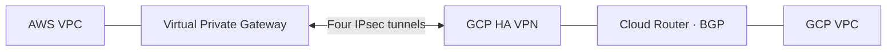

# AWS ↔ GCP HA VPN

A personal Terraform project connecting AWS and Google Cloud through four IPsec tunnels with BGP routing, Vault-managed tunnel keys, temporary deployment credentials, logging, and alerts.

## A problem I solved

IPsec was up, but BGP would not establish because both ends used the same inside-tunnel IP. I corrected the Terraform addressing: AWS uses the first usable host in each `/30`, and GCP uses the second.

## Demo

[Watch the one-minute demo](demo/aws-gcp-console-terminal-failover.mp4) · [Deploy it](SETUP.md)
