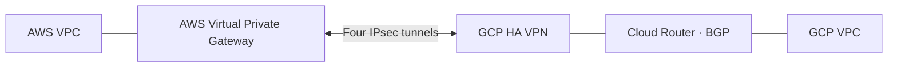

# AWS ↔ GCP HA VPN with Terraform

I built and tested a four-tunnel VPN between AWS and Google Cloud, using Terraform to automate the infrastructure and BGP routing.

## What I built

- AWS Virtual Private Gateway connected to both GCP HA VPN interfaces through four IPsec tunnels.
- Private subnets, BGP route exchange, and AWS route propagation.
- AWS STS sessions, GCP service-account impersonation, and separate tunnel keys in Vault.
- Tunnel logging, monitoring alerts, and CI with Terraform validation, TFLint, and Checkov.

## Architecture

## A problem I solved

All four IPsec tunnels were up, but BGP would not establish. I found that GCP and AWS were using the same inside-tunnel IP address. Correcting one interface confirmed the cause; I then configured Terraform to assign GCP the second usable address in each `/30` and peer with AWS’s first address.

## Demo

I verified private-IP connectivity in both directions and tested BGP failover through each surviving tunnel pair.

[Watch the one-minute console and terminal demo](demo/aws-gcp-console-terminal-failover.mp4).

## Try it

[Deployment guide](SETUP.md) · [Authentication and Vault](AUTHENTICATION.md) · [Test results](TEST-RESULTS.md)
